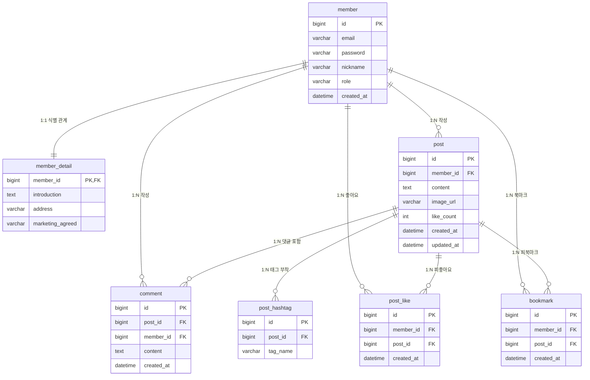

# **JPA 핵심 원리와 개발 환경 구축**

## **1. JPA 도입 배경**

- 기존 데이터 접근 기술의 발전과 한계
    - 순수 JDBC: 데이터베이스 연결부터 쿼리 실행, 자원 해제까지 수많은 보일러플레이트 코드를 직접 작성해야 하고 SQL이 자바 코드 내에 하드코딩되는 문제가 발생함.
    - JdbcTemplate: 반복적인 자원 관리와 예외 처리는 프레임워크가 자동화했으나, 여전히 자바 코드 안에 SQL 문자열이 혼재되어 가독성이 떨어지고 쿼리 결과를 객체로 매핑하는 코드를 수작업으로 작성해야 함.
    - MyBatis: SQL 문을 XML 파일로 분리하여 자바 코드와 격리하는 데는 성공했으나, 테이블 컬럼이 하나만 추가되거나 수정되어도 관련된 모든 CRUD(등록, 수정, 삭제, 조회) SQL과 DTO 매핑을 개발자가 일일이 수작업으로 변경해야 함.
    - 공통적인 한계: 애플리케이션의 핵심인 비즈니스 로직 개발보다 테이블 구조에 맞춘 SQL 쿼리를 작성하고 유지보수하는 데 대부분의 개발 리소스가 소모됨.
- 객체와 테이블의 일체화를 통한 쿼리 자동 생성
    - 자바 객체와 데이터베이스 테이블을 1:1로 일체화(매핑)시켜 둘 수 있다면, 기본적인 등록(INSERT), 수정(UPDATE), 삭제(DELETE), 단건 조회(SELECT) 쿼리는 프레임워크가 객체 정보를 기반으로 스스로 생성해 줄 수 있음.
    - 개발자가 직접 SQL 문을 작성하는 대신 자바 코드로 객체 상태를 조작하면, 프레임워크가 테이블 구조에 맞는 쿼리를 동적으로 완성하여 데이터베이스와 통신을 처리함.
    - 이러한 객체와 테이블의 일체화를 표준화하여 개발자가 객체 중심의 도메인 설계에 전념할 수 있도록 지원하는 핵심 기술이 ORM과 JPA에 해당함.

### **1.1 ORM의 매핑 원리와 JPA 및 하이버네이트의 역할**

#### **1) ORM의 매핑 원리**

- ORM (Object-Relational Mapping)은 객체지향 프로그래밍의 객체 구조와 관계형 데이터베이스의 테이블 구조 간의 차이를 중간에서 자동으로 연결하여 해결하는 매핑 기술.
- 객체는 객체지향 원칙에 따라 설계하고 데이터베이스는 관계형 모델에 맞추어 설계한 뒤, 둘 사이의 매핑 설정을 기반으로 프레임워크가 SQL을 동적으로 자동 생성하여 영속화 [각주]를 대행함.
- 개발자는 반복적인 CRUD SQL 작성에서 벗어나 도메인의 비즈니스 로직에 집중할 수 있음.

#### **2) JPA 표준 명세 인터페이스**

- JPA (Java Persistence API)는 자바 플랫폼에서 ORM 기술을 사용하기 위한 표준 인터페이스 규약의 모음.
- 특정 구현 기술에 종속되지 않도록 인터페이스 형태로 정의되어 있으며, 데이터 접근 계층의 표준화를 지원함.
- 개발자는 JPA 표준 인터페이스(EntityManager 등)를 기반으로 코드를 작성함.

#### **3) 하이버네이트 구현체**

- 하이버네이트 (Hibernate)는 JPA 표준 인터페이스 명세를 실제로 구현한 대표적인 오픈소스 ORM 프레임워크.
- JPA가 추상화된 표준 설계도(인터페이스)라면, 하이버네이트는 해당 설계도에 따라 실제로 데이터베이스와 통신하고 쿼리를 생성하는 구체적인 엔진(구현체)에 해당함.
- 개발자가 작성한 객체 조작 명령을 해석하여 대상 데이터베이스의 독자적인 문법에 최적화된 SQL을 생성하고 실행을 담당함.

### **1.2 객체와 관계형 데이터베이스의 패러다임 불일치와 JPA의 해결 방안**

관계형 데이터베이스 (RDB)는 데이터를 정규화된 테이블 구조로 저장하고 관리하는 데 집중하며, 객체지향 프로그래밍 언어는 상태와 행위를 캡슐화한 객체 중심의 설계를 지향함. 서로 다른 철학에서 비롯되는 이러한 구조적 차이를 패러다임 불일치라고 부르며, 상속, 연관관계, 객체 탐색 방식에서 대표적인 충돌이 발생함. JPA는 이러한 패러다임 불일치를 극복하고 객체 중심 설계를 유지할 수 있도록 지원함.

#### **1) 상속 구조의 불일치**

- 객체의 상속 구조를 RDB에 영속화해야 하는 이유
    - 비즈니스 요구사항을 객체지향적으로 모델링할 때, 공통 속성과 개별 속성을 분리하고 다형성을 활용하기 위해 클래스 상속을 자연스럽게 사용함.
    - 예를 들어 SNS 서비스에서 회원(Member: id, email, password, created_at 등)을 부모 클래스로 두고, 일반 사용자(User: nickname, profile_image 등)와 관리자(Admin: department, security_level 등)를 자식 클래스로 상속 설계하는 경우를 들 수 있음.
    - 애플리케이션 메모리에서 생성된 객체의 데이터는 시스템이 재시작되더라도 유지되어야 하므로, 영구 데이터 저장소인 데이터베이스에 저장해야 함.
    - 따라서 메모리상의 객체 상속 데이터를 RDB 테이블 구조로 변환하여 보관해야 하는 과제가 발생함.
- 상속 지원 부재와 슈퍼타입-서브타입 모델 차용
    - 객체지향 언어는 상속과 다형성을 언어 차원에서 기본 문법으로 지원함.
    - 반면 관계형 데이터베이스는 테이블 간의 상속이라는 문법과 기능이 지원되지 않음.
    - 결국 RDB 환경에서 객체의 상속 데이터를 담아내기 위해, 데이터 모델링 이론 중 상속과 구조적으로 가장 유사한 슈퍼타입-서브타입 관계 모델(예: member 슈퍼타입 테이블과 user, admin 서브타입 테이블)을 대안으로 차용하여 테이블을 설계하게 됨.
- 개발자가 마주하는 SQL 변환 부담
    - 자바에서는 단순히 부모 클래스를 상속받아 Admin 객체를 생성하면 되지만, 데이터베이스에 저장할 때는 슈퍼타입(member)과 서브타입(admin) 테이블에 각각 INSERT SQL을 2번씩 나누어 작성해야 함.
    - 데이터를 조회할 때도 매번 두 테이블을 JOIN하는 복잡한 쿼리를 작성하고 결과를 자바 객체로 재조립해야 하는 번거로움이 발생함.
    - 이러한 패러다임 불일치로 인해 개발자는 점차 객체지향 설계를 포기하고, member 테이블 하나에 role 컬럼을 두고 관리자 전용 컬럼(department, security_level)을 모두 NULL 허용으로 몰아넣는 단순 평면 구조의 테이블과 객체만 설계하게 됨.
- JPA의 상속 매핑 해결 방안
    - 개발자가 자바 컬렉션에 객체를 다루듯이 엔티티를 영속화하면, JPA가 상속 매핑 설정을 기반으로 `member`와 `admin` 테이블에 필요한 INSERT 및 JOIN SELECT SQL을 동적으로 자동 생성하여 객체지향 다형성을 온전히 보장함.

#### **2) 연관관계 표현 방식**

- 객체의 연관관계와 단방향 참조
    - 객체지향 프로그래밍에서 한 객체가 다른 객체와 연관관계를 맺으려면, 상대방 객체의 인스턴스 주소를 보관하는 참조(Reference) 변수를 필드로 선언해야 함.
    - 예를 들어 SNS 서비스에서 게시글(Post)이 작성자 회원(Member) 정보를 알고자 할 때, 게시글 클래스 내부에 `private Member member;` 형태의 참조 변수를 정의함.
    - 이 참조는 출발지 객체에서 목적지 객체로만 향하는 단방향 특성을 지니므로, `post.getMember()`를 통한 탐색은 가능하지만 반대로 Member 객체에서 자신이 작성한 게시글을 거꾸로 탐색할 수는 없음.
    - 객체 세상에서 양방향 탐색을 구현하려면 양쪽 클래스 모두에 서로를 가리키는 단방향 참조 변수(Post의 `member`, Member의 `List<Post> posts`)를 각각 선언하여 2개의 단방향을 인위적으로 연결해야 함.
- 관계형 데이터베이스의 외래 키 연관관계
    - RDB는 참조 변수라는 문법이 없으며, 테이블 간의 연관관계를 오직 외래 키 (FK) 컬럼 하나로만 정의함.
    - 게시글 테이블에 `member_id` 외래 키 컬럼 하나만 존재하면, 게시글 기준 조인이든 회원 기준 조인이든 상관없이 방향성 없는 양방향 조회가 가능함.
- 패러다임 불일치로 인한 객체 모델의 왜곡
    - 객체지향 설계 관점에서는 게시글이 회원의 참조 변수(`Member member`)를 직접 가지고 있어야 점(.) 연산자로 자유롭게 객체를 탐색할 수 있음.
    - 하지만 SQL 중심 개발 환경에서는 데이터베이스 외래 키 구조에 맞추기 위해 `Long memberId`와 같은 단순 식별자 숫자 값을 게시글 객체에 보관하는 왜곡이 발생함.
    - 결국 객체지향의 장점인 객체 간 협력과 참조 탐색이 어려워지고, 객체가 단순한 데이터 전달용 바구니(데이터 홀더)로 전락하게 됨.
- JPA의 연관관계 매핑 해결 방안
    - 개발자는 객체 세상에서 참조 변수(`post.setMember(member)`)를 그대로 사용하고, JPA는 연관관계 매핑 설정을 바탕으로 데이터베이스 외래 키(`member_id`)를 추출하여 SQL에 바인딩함으로써 객체 모델 왜곡 없이 참조와 외래 키를 자동으로 연결함.

#### **3) 객체 그래프 탐색과 동일성의 한계**

- 객체 그래프 탐색의 제한
    - 객체 세상에서는 점(.) 연산자를 통해 연결된 다른 객체를 자유롭게 타고 들어갈 수 있어야 함(예: `post.getMember().getNickname()`).
    - 하지만 SQL 매퍼 라이브러리 환경에서는 처음에 실행한 SQL이 작성자(Member) 테이블을 조인해서 함께 조회해오지 않았다면, `post.getMember()`를 호출했을 때 `null`이 반환되어 `NullPointerException`이 발생함.
    - 결국 서비스 계층의 비즈니스 로직은 DAO의 SQL이 실제로 어떤 테이블까지 JOIN해서 채워주었는지 직접 코드를 확인하기 전에는 객체를 마음 놓고 탐색할 수 없음.
    - 이로 인해 화면 요구사항에 맞추어 `selectPost()`, `selectPostWithMember()`, `selectPostWithComments()`처럼 탐색 깊이마다 전용 조회 메서드를 따로따로 계속해서 만들어야 하는 문제가 발생함.
- 객체 동일성 불일치
    - 데이터베이스의 동일한 행(Row)을 두 번 조회하더라도, 매번 `new` 키워드로 새로운 자바 인스턴스가 생성되어 반환되므로 `==` 비교 시 서로 다른 객체로 판정되는 문제가 발생함.
- JPA의 탐색 및 동일성 보장 해결 방안
    - 연관된 엔티티가 실제로 필요한 시점까지 조회를 미루는 지연 로딩(Lazy Loading) 메커니즘을 지원하여, 최초 조회 시점이 아니더라도 점(.) 연산자를 통해 객체 그래프를 제약 없이 탐색하도록 지원함.
    - 동일한 트랜잭션 범위 내에서는 동일한 식별자(PK)로 조회한 엔티티의 1차 캐시 인스턴스 주소를 재사용하므로, 자바의 `==` 동일성 비교를 보장함.

## **2. Spring Boot Data JPA 환경 구축과 설정**

### **2.1 Spring Boot 프로젝트 생성**

#### **1) 새 프로젝트 시작**

- IntelliJ IDEA > File > New > Project...

#### **2) Spring Boot 선택**

- 생성창 좌측의 Generators 목록 중에서 Spring Boot 선택

#### **3) 프로젝트 기본 정보 입력**

- Name: `jpa-sns`
- Location(프로젝트를 생성할 폴더 선택): `c:/bebc25/springboot-yong`(예시)
- Language: Java
- Type: Gradle - Groovy
- Group: `net.likelion.bebc25`
- Artifact: `jpa-sns`
- Package name: `net.likelion.bebc25.jpasns`
- JDK(컴파일러/런타임): 25 Eclipse Temurin
- Java(코드내의 Java 문법 버전): 25
- Packaging: Jar
- Configuration: YAML
- Next 클릭

#### **4) 스프링 부트 버전 및 의존성 라이브러리 선택**

- Spring Boot: 4.1.1
- Dependencies
    - Developer Tools > `Lombok`: 자바 보일러플레이트 코드 자동화
    - Web > `Spring Web`: RESTful 웹 서비스 및 컨트롤러 아키텍처 지원
    - SQL > `Spring Data JPA`: 하이버네이트 기반 ORM 영속성 관리 및 공통 리포지토리 인터페이스 지원
    - SQL > `MySQL Driver`: MySQL 데이터베이스 연동 드라이버
- Create 버튼 클릭

#### **5) build.gradle 설정 추가**

```
tasks.named('test') {
    useJUnitPlatform()
    // Mockito 동적 에이전트 및 CDS 공유 경고 비활성화
    jvmArgs('-XX:+EnableDynamicAgentLoading', '-Xshare:off')
}
```

#### **6) application.yaml 설정 (src/main/resources/application.yaml)**

```yaml
spring:
  application:
    name: jpa-sns
  # 데이터베이스 접속 정보
  datasource:
    driver-class-name: com.mysql.cj.jdbc.Driver
    url: 'jdbc:mysql://localhost:3306/jpa_db?serverTimezone=UTC&useSSL=false&allowPublicKeyRetrieval=true'
    username: jpa-app
    password: 'Jpa1234!'

  # JPA 및 하이버네이트 설정
  jpa:
    hibernate:
      ddl-auto: create
    properties:
      hibernate:
        show_sql: true
        format_sql: true
        use_sql_comments: true
```

### **2.2 JPA 실행 옵션과 성능 설정**

- ddl-auto 옵션의 종류와 동작 방식
    - `none`: DDL 자동 생성 기능을 완전히 비활성화함. 데이터베이스 구조를 변경하지 않음.
    - `create`: 애플리케이션 시작 시점에 기존 테이블을 삭제(DROP)하고 엔티티 매핑 정보를 바탕으로 새로 생성(CREATE)함. 기존 데이터가 완전히 유실됨.
    - `create-drop`: create와 동일하게 시작 시 새로 생성하며, 애플리케이션 종료 시점에 생성된 테이블을 삭제(DROP)함. 주로 단위 테스트 환경에서 활용함.
    - `update`: 데이터베이스의 기존 테이블 구조와 엔티티 필드를 비교하여 변경되거나 추가된 컬럼만 반영(ALTER)함. 기존 데이터는 보존되지만, 엔티티에서 필드를 삭제하더라도 실제 DB 컬럼은 삭제되지 않고 유지됨.
    - `validate`: 테이블을 생성하거나 수정하지 않고, 엔티티 매핑 정보와 실제 데이터베이스 테이블 구조가 일치하는지만 검증함. 차이가 발생하면 애플리케이션 기동에 실패함.
- 스프링 부트의 기본 ddl-auto 판정 메커니즘
    - 내장 메모리 DB(H2 등): ddl-auto 설정을 명시하지 않으면 기본적으로 `create-drop`이 적용됨.
    - 외부 DB(MySQL, PostgreSQL 등): ddl-auto 설정을 명시하지 않으면 기본적으로 `none`이 적용됨.
- 환경별(프로파일) ddl-auto 설정 원칙
    - 로컬 및 개발 환경: 빠른 프로토타입 구현 및 매핑 검증을 위해 `update` 사용 허용
    - 테스트 환경: 격리된 단위 테스트 실행을 위해 H2 메모리 DB 기반 `create-drop` 활용
    - 실무 운영 환경: 대량 데이터 유실 및 테이블 락(Lock) 장애를 원천 차단하기 위해 개발자가 운영 프로파일(application-prod.yaml)에 직접 `none` 또는 `validate`로 설정하여 관리해야 함. 실무 운영 DB의 스키마 변경은 JPA의 자동 DDL이 아닌 SQL 스크립트를 통해 직접 수행함.
- 하이버네이트 로깅 및 디버깅 옵션
    - `show_sql`: 하이버네이트가 실행하는 SQL을 콘솔에 출력하도록 지정함. 로컬 개발 단계에서 생성 쿼리를 확인하고자 할 때 활용함.
    - `format_sql`: 한 줄로 길게 출력되는 SQL 문장을 들여쓰기와 줄바꿈이 적용된 정렬 형태로 변환하여 출력함으로써 쿼리 가독성을 높여줌.
    - `use_sql_comments`: 실행되는 SQL 상단에 대상 엔티티 조작이나 원본 JPQL 등의 실행 원인을 주석(`/* ... */`)으로 함께 표기하여 디버깅 추적을 지원함.

### **2.3 database 생성**

```sql
-- 1. jpa_db 데이터베이스 생성
DROP DATABASE IF EXISTS `jpa_db`;
CREATE DATABASE IF NOT EXISTS `jpa_db`
  DEFAULT CHARACTER SET utf8mb4
  DEFAULT COLLATE utf8mb4_unicode_ci;

-- 2. 사용자 계정 생성
DROP USER IF EXISTS 'jpa-app';
CREATE USER IF NOT EXISTS 'jpa-app'@'%' IDENTIFIED BY 'Jpa1234!';

-- 3. jpa_db에 대한 모든 권한 부여
GRANT ALL PRIVILEGES ON `jpa_db`.* TO 'jpa-app'@'%';
```

# **SNS 도메인 엔티티 매핑**

- 엔티티(Entity)의 정의 및 특징
    - 데이터베이스 테이블과 직접 매핑되어 실제 데이터의 개별 행(Row)을 표현하는 자바 객체.
    - 데이터베이스의 기본 키(Primary Key)와 연결되는 고유한 식별자(`@Id`)를 보유하여 객체의 생명주기 동안 식별성을 유지함.
    - 단순한 데이터 전달용 객체(DTO)와 달리 비즈니스 로직과 상태를 내부에 함께 캡슐화한 도메인 모델의 핵심 단위.
    - JPA 영속성 컨텍스트의 관리 대상이 되어 1차 캐시 보관 [각주], 변경 감지 [각주] (Dirty Checking), 지연 로딩 [각주] 등의 영속성 라이프사이클 지원을 받음.
- SNS 도메인 핵심 엔티티 구성
    - `Member`: 서비스 가입 회원의 기본 계정 정보(이메일, 비밀번호, 닉네임)를 관리하는 핵심 엔티티.
    - `MemberDetail`: 회원의 상세 소개글, 주소, 마케팅 수신동의 등 부가 정보를 분리하여 관리하는 엔티티.
    - `Post`: 사용자가 피드에 작성하는 본문 텍스트, 이미지 경로, 좋아요 수를 기록하는 게시글 엔티티.
    - `Comment`: 특정 게시글에 회원들이 작성하는 댓글 정보를 관리하는 엔티티.
    - `PostLike`: 회원이 특정 게시글에 등록한 좋아요 내역을 기록하는 상호작용 엔티티.
    - `Bookmark`: 회원이 다시 찾아보기 위해 저장해 둔 게시글 북마크 내역을 관리하는 엔티티.
    - `PostHashtag`: 게시글에 첨부되어 관심사 기반 검색과 분류를 지원하는 해시태그 엔티티.

## **1. SNS 도메인 ERD**

- SNS 7개 핵심 테이블 간의 식별 및 비식별 관계 구조



## **2. 핵심 엔티티 작성 (Member, Post)**

- Member 엔티티 (src/main/java/net/likelion/bebc25/jpasns/domain/Member.java)

    ```java
    package net.likelion.bebc25.jpasns.domain;
    
    import jakarta.persistence.Entity;
    import jakarta.persistence.GeneratedValue;
    import jakarta.persistence.GenerationType;
    import jakarta.persistence.Id;
    import lombok.AccessLevel;
    import lombok.Getter;
    import lombok.NoArgsConstructor;
    
    import java.time.LocalDateTime;
    
    @Entity
    @Getter
    @NoArgsConstructor(access = AccessLevel.PROTECTED)
    public class Member {
    
        @Id
        @GeneratedValue(strategy = GenerationType.IDENTITY)
        private Long id;
    
        private String email;
        private String password;
        private String nickname;
        private String role;
        private LocalDateTime createdAt;
    
        public Member(String email, String password, String nickname) {
            this(email, password, nickname, "USER");
        }
    
        public Member(String email, String password, String nickname, String role) {
            this.email = email;
            this.password = password;
            this.nickname = nickname;
            this.role = role;
            this.createdAt = LocalDateTime.now();
        }
    }
    ```

- Post 엔티티 (src/main/java/net/likelion/bebc25/jpasns/domain/Post.java)

    ```java
    package net.likelion.bebc25.jpasns.domain;
    
    import jakarta.persistence.Entity;
    import jakarta.persistence.GeneratedValue;
    import jakarta.persistence.GenerationType;
    import jakarta.persistence.Id;
    import lombok.AccessLevel;
    import lombok.Getter;
    import lombok.NoArgsConstructor;
    
    import java.time.LocalDateTime;
    
    @Entity
    @Getter
    @NoArgsConstructor(access = AccessLevel.PROTECTED)
    public class Post {
    
        @Id
        @GeneratedValue(strategy = GenerationType.IDENTITY)
        private Long id;
    
        private String content;
        private String imageUrl;
        private int likeCount;
        private Long memberId; // 테이블의 member_id FK를 단순 Long 값으로 보관
        private LocalDateTime createdAt;
        private LocalDateTime updatedAt;
    
        public Post(String content, Long memberId) {
            this(content, null, memberId);
        }
    
        public Post(String content, String imageUrl, Long memberId) {
            this.content = content;
            this.imageUrl = imageUrl;
            this.memberId = memberId;
            this.likeCount = 0;
            this.createdAt = LocalDateTime.now();
            this.updatedAt = LocalDateTime.now();
        }
    
    }
    ```


## **3. Member, Post 테스트 케이스 작성**

- MemberPostTest (src/test/java/net/likelion/bebc25/jpasns/domain/MemberPostTest.java)

    ```java
    package net.likelion.bebc25.jpasns.domain;
    
    import jakarta.persistence.EntityManager;
    import org.junit.jupiter.api.BeforeEach;
    import org.junit.jupiter.api.DisplayName;
    import org.junit.jupiter.api.Test;
    import org.springframework.beans.factory.annotation.Autowired;
    import org.springframework.boot.test.context.SpringBootTest;
    import org.springframework.transaction.annotation.Transactional;
    
    import static org.assertj.core.api.Assertions.assertThat;
    
    @SpringBootTest
    @Transactional
    class MemberPostTest {
    
        @Autowired
        private EntityManager em;
    
        private Long savedMemberId;
    
        @BeforeEach
        void setUp() {
            // 각 테스트 실행 전 독립된 트랜잭션 내에서 기본 회원 생성
            Member member = new Member("user@test.com", "1234", "테스터");
            em.persist(member);
            this.savedMemberId = member.getId();
    
            em.flush();
            em.clear();
        }
    
        @Test
        @DisplayName("회원 등록 및 조회 검증")
        void memberSaveAndFind() {
            Member findMember = em.find(Member.class, savedMemberId);
    
            assertThat(findMember).isNotNull();
            assertThat(findMember.getEmail()).isEqualTo("user@test.com");
            assertThat(findMember.getNickname()).isEqualTo("테스터");
            assertThat(findMember.getRole()).isEqualTo("USER");
        }
    
        @Test
        @DisplayName("게시글 등록 및 조회 검증")
        void postSaveAndFind() {
            // 1. 게시글 생성 및 영속화 (사전 등록된 savedMemberId 활용)
            Post post = new Post("첫 번째 게시글 내용", savedMemberId);
            em.persist(post);
    
            em.flush();
            em.clear();
    
            // 2. 조회 검증
            Post findPost = em.find(Post.class, post.getId());
    
            assertThat(findPost).isNotNull();
            assertThat(findPost.getContent()).isEqualTo("첫 번째 게시글 내용");
            assertThat(findPost.getMemberId()).isEqualTo(savedMemberId);
            assertThat(findPost.getLikeCount()).isEqualTo(0);
        }
    }
    ```

- 하이버네이트 콘솔 실행 로그 확인

    ```java
    /* 테이블 자동 생성 DDL */
    create table member (
        id bigint not null auto_increment,
        email varchar(255),
        password varchar(255),
        nickname varchar(255),
        role varchar(255),
        created_at datetime(6),
        primary key (id)
    ) engine=InnoDB;
    
    create table post (
        id bigint not null auto_increment,
        content varchar(255),
        image_url varchar(255),
        like_count integer not null,
        member_id bigint,
        created_at datetime(6),
        updated_at datetime(6),
        primary key (id)
    ) engine=InnoDB;
    
    /* 엔티티 영속화 INSERT SQL */
    insert into member (created_at, email, password, nickname, role) values (?, ?, ?, ?, ?);
    insert into post (content, created_at, image_url, like_count, member_id, updated_at) values (?, ?, ?, ?, ?, ?);
    ```